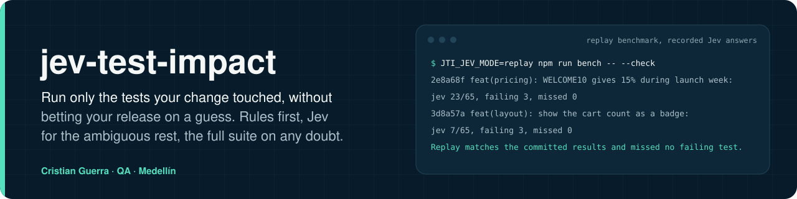
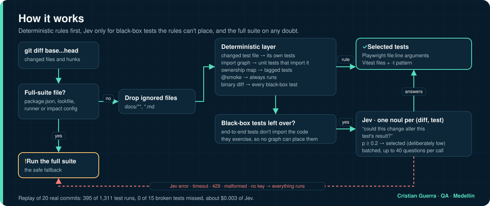
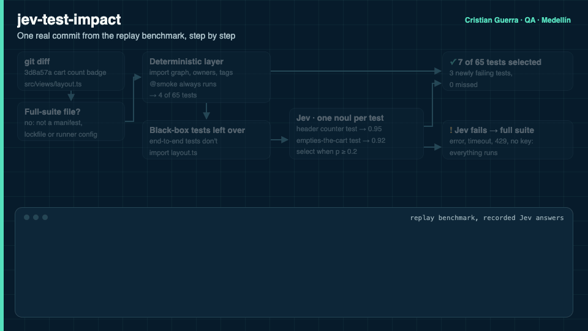

# jev-test-impact

[Read in English](README.md)



**Corra solo las pruebas que su cambio tocó, sin apostar su release a una suposición.**

[](https://github.com/criguex/jev-test-impact/actions/workflows/ci.yml)

La mayoría de los pull requests tocan pocos archivos, pero el CI corre todas las pruebas. `jev-test-impact` lee el diff y escoge las pruebas que pueden verse afectadas. Lo hace en dos capas:

1. **Primero, reglas deterministas.** El grafo de imports, un mapa de ownership y los tags deciden todo lo que el código puede decidir con exactitud.
2. **[Jev](https://docs.typesafe.ai) solo para el resto ambiguo.** Las pruebas end-to-end no importan el código que ejercitan, así que ningún grafo puede conectar `src/views/layout.ts` con "agregar un libro actualiza el contador del encabezado". Para esos pares Jev responde una sola pregunta tipada de sí o no, *"¿este cambio podría alterar el resultado de esta prueba?"*, y devuelve una probabilidad calibrada en vez de prosa.

Si Jev está lento, caído, con límite de tasa o devuelve algo raro, **corren todas las pruebas**. La incertidumbre nunca hace que una prueba se salte.

## Explicado simple

**El problema.** Cada vez que alguien cambia una línea de código, el sistema de integración continua corre *todas* las pruebas del producto. Es como mandar a revisar todo el carro, llantas, frenos, luces y motor, porque se cambió el espejo retrovisor. Es seguro, pero lento y caro, y el equipo espera.

**La idea.** Revisar solo lo que el cambio pudo haber tocado, sin arriesgarse a dejar pasar un daño.

**Cómo decide, en dos pasos:**

1. **Primero, lo que se puede saber con certeza.** El código sabe qué pruebas usan qué archivos, como un plano del carro. Si cambió el espejo, sabemos exactamente qué piezas lo tocan. Eso no necesita IA.
2. **Después, solo para lo dudoso, se le pregunta a Jev.** Algunas pruebas miran el producto "desde afuera", como un cliente que maneja el carro, y el plano no dice si el cambio las afecta. Para esas le preguntamos a Jev, una IA que no escribe textos: responde sí o no con un porcentaje de confianza ("85% de que sí puede afectar"). Si hay una duda razonable, desde un 20%, la prueba se corre.

**La regla de oro.** Si Jev falla, tarda o no está disponible, se corren todas las pruebas. Ante la duda, nunca se salta nada. Además, todas las noches y en cada entrega final se corre la batería completa como red de seguridad.

**¿Funciona?** Lo medimos reproduciendo 20 cambios reales de una tienda de ejemplo en la que sembramos 6 errores a propósito:

- Se corrieron **70% menos pruebas** y el tiempo medido bajó de 143 s a 83 s (**42% menos**).
- Se detectaron **todas** las pruebas que se rompieron (15 de 15) y los 6 cambios con error.
- Sin la ayuda de Jev, la versión "rápida" dejaba escapar 4 de las 15 fallas. La versión "segura" sin Jev ahorraba mucho menos tiempo.
- Todas las consultas a Jev del experimento costaron menos de un centavo de dólar.

Es una prueba en una aplicación pequeña. En su proyecto el ahorro real se mide con su propio historial, que es justamente lo que ofrece el servicio.

## Resultados medidos

El benchmark reproduce la historia real de git de una pequeña tienda demo ([`demo/`](demo), 46 pruebas unitarias con Vitest + 18 pruebas end-to-end con Playwright) a lo largo de **20 commits**. Seis de ellos traen regresiones realistas y entre todos rompen 15 pruebas. Para cada commit se corrió la suite completa una vez para registrar qué pruebas se rompían de verdad. Después cada política escogió sus pruebas solo a partir del diff.

| Política | Pruebas corridas | Saltadas | Tiempo de pruebas (suma de duraciones) | Tiempo de reloj medido | Pruebas nuevas en falla que se escaparon | Commits con regresión detectados |
| --- | --- | --- | --- | --- | --- | --- |
| Suite completa | 1311 | 0% | 206.1 s | 143.4 s | 0 de 15 | 6 de 6 |
| Solo determinista, e2e sin mapear saltadas (insegura) | 301 | 77.0% | 59.7 s | 70.5 s | **4 de 15** | 5 de 6 |
| Solo determinista, e2e sin mapear todas corridas | 527 | 59.8% | 193.8 s | 95.5 s | 0 de 15 | 6 de 6 |
| **Determinista + Jev (este proyecto)** | **395** | **69.9%** | **122.5 s** | **83.4 s** | **0 de 15** | **6 de 6** |

- Costo de Jev en todo el replay: 18 llamadas, 231 preguntas, 68.852 tokens de entrada, **alrededor de $0.003**.
- El tiempo de reloj se midió en un portátil Apple Silicon corriendo de verdad cada selección. Incluye el arranque del runner y del navegador, por eso baja menos que el tiempo de pruebas.
- Cuatro de las 15 pruebas rotas solo las podía atrapar Jev. Les dio 0.93, 0.95, 0.92 y 0.71, contra un umbral de selección de 0.2. La fila "insegura" muestra qué pasa sin esa capa: una selección rápida que deja salir un badge del carrito roto y un checkout roto.
- Detalle completo por commit: [`bench/RESULTS.md`](bench/RESULTS.md). Datos crudos: [`bench/results.json`](bench/results.json) y [`bench/ground-truth.json`](bench/ground-truth.json).

Estos números vienen de una sola app demo pequeña con 6 regresiones sembradas. Muestran que el método funciona y es seguro en esa historia. No predicen el ahorro en su código, y la sección [Servicio](#servicio) explica cómo medirlo.

## Cómo funciona





La animación sigue un commit real del benchmark (`3d8a57a`, el badge del carrito) y muestra la salida real de `JTI_JEV_MODE=replay npm run bench -- --check` ([versión MP4](docs/assets/how-it-works.mp4)). Fuente: [`docs/scenes/how-it-works.html`](docs/scenes/how-it-works.html), renderizada con [`docs/scenes/export.sh`](docs/scenes/export.sh). Las imágenes están en inglés y son las mismas en las dos versiones del README.

**Política de seguridad, aplicada en código ([`src/select.ts`](src/select.ts)):**

- Una prueba corre si alguna regla determinista la selecciona **o** si la probabilidad de Jev es igual o mayor a `jev.threshold` (por defecto `0.2`, bajo a propósito).
- Las pruebas `@smoke` siempre corren.
- Los cambios en archivos de `fullSuiteOn` (manifiestos de paquetes, lockfiles, configuraciones de runners, la configuración de impacto) corren todo.
- Un cambio sin diff legible (archivos binarios) selecciona todas las pruebas de caja negra.
- Cualquier falla de Jev (red, error HTTP, respuesta malformada, respuesta faltante) corre la suite completa, y el cuerpo del error queda en el log.
- La suite completa sigue corriendo en `main` y cada noche ([`ci.yml`](.github/workflows/ci.yml)), así que un hueco del selector solo puede retrasar la detección unas horas. Nunca puede esconder un bug para siempre.

**Qué se le pregunta a Jev.** El `state` es el diff de un archivo: su ruta, su estado y los hunks con las líneas quitadas y agregadas. Cada pregunta es un `noul` cuyo objeto `instructions` lleva el archivo de la prueba, la ruta de su título y sus pasos. Los pasos son el cuerpo de la prueba más las funciones auxiliares locales que llama. Las preguntas se agrupan hasta 40 por llamada. Ver [`src/jev/judge.ts`](src/jev/judge.ts). El texto de la pregunta y los criterios viven en un solo lugar para que sea fácil revisarlos.

## Inicio rápido

Requiere Node 22+ y git.

```bash
git clone https://github.com/criguex/jev-test-impact && cd jev-test-impact
npm ci
npm test                          # pruebas unitarias de la herramienta
JTI_JEV_MODE=replay npm run bench # benchmark offline, con las respuestas grabadas de Jev
```

Úselo en un proyecto que tenga un `impact.config.json` (ver [`demo/impact.config.json`](demo/impact.config.json)):

```bash
# Explicar la selección
npx github:criguex/jev-test-impact select --base origin/main

# Correr solo las pruebas afectadas de una suite (la salta si no hay nada afectado, corre todo en fail-safe)
npx github:criguex/jev-test-impact run --suite e2e  --base origin/main -- npx playwright test
npx github:criguex/jev-test-impact run --suite unit --base origin/main -- npx vitest run

# En GitHub Actions: escribe step outputs (unit=all|some|skip, unit_args=...) y una tabla en el job summary
npx github:criguex/jev-test-impact select --base origin/${{ github.base_ref }} --format github
```

Hay un workflow listo para copiar en [`examples/github-action.yml`](examples/github-action.yml). Este repositorio usa el mismo flujo sobre su propia demo en [`.github/workflows/impact.yml`](.github/workflows/impact.yml).

**Acceso a Jev.** Defina `TYPESAFE_API_KEY` (directo) o `AI_GATEWAY_API_KEY` (Vercel AI Gateway, `POST https://ai-gateway.vercel.sh/typesafe/v1/systemone`). Las dos formas de respuesta se normalizan: el `noul` nativo y el `boolean`/`probability` del gateway.

| `JTI_JEV_MODE` | Comportamiento |
| --- | --- |
| `auto` (por defecto) | Usa una respuesta grabada si existe; si no, llama a Jev en vivo y la graba |
| `replay` | Solo respuestas grabadas. Si falta una, Jev no puede responder y corre la suite completa |
| `record` | Siempre llama en vivo y sobrescribe las grabaciones |
| `live` | Siempre llama en vivo, nunca graba |

Las grabaciones se indexan con un hash de la solicitud exacta, así que un diff o una pregunta que cambió nunca puede reutilizar una respuesta vieja.

## Configuración

```jsonc
{
  "suites": [
    { "name": "unit", "runner": "vitest", "include": ["tests/unit/**/*.test.ts"], "strategy": "import-graph" },
    { "name": "e2e", "runner": "playwright", "include": ["tests/e2e/**/*.spec.ts"], "strategy": "black-box" }
  ],
  "alwaysRun": ["@smoke"],
  "fullSuiteOn": ["package.json", "package-lock.json", "playwright.config.ts", "vitest.config.ts", "impact.config.json"],
  "ignore": ["**/*.md", "docs/**"],
  "owners": [{ "files": ["src/auth.ts", "src/views/login.ts"], "tags": ["@auth"] }],
  "jev": { "threshold": 0.2, "maxQuestionsPerCall": 40 }
}
```

- Las suites `import-graph` confían en el grafo estático de imports: si una prueba unitaria no importa el archivo cambiado, ni directa ni transitivamente, no está afectada.
- Las suites `black-box` (end-to-end, API, contrato) nunca confían en ese "no". Las pruebas que las reglas no seleccionan van a Jev.
- `owners` es opcional y puede quedar incompleto. El mapa de la demo deja por fuera a propósito los archivos de layout, servidor y carrito, y Jev cubrió esos huecos en el benchmark.

## Reproducir el benchmark

```bash
npm run bench:truth          # reconstruye la historia de la demo desde bench/history/*.patch y corre la suite completa por commit (~3 min)
npm run bench -- --execute   # selecciona por commit con cada política y cronometra las corridas seleccionadas
npm run bench -- --check     # CI: el replay offline debe coincidir con bench/results.json y no dejar escapar nada
```

La historia de la demo se guarda como archivos de `git format-patch` y se reconstruye con fechas fijas, así que los SHA de los commits salen iguales en cualquier máquina. `demo/` es el commit base de esa historia, así que cualquier edición ahí deja vieja la verdad grabada, y `--check` falla hasta que se vuelvan a correr `bench:truth` y `bench`.

## En qué se diferencia de `jev-test-filter`

[mizchi/jev-test-filter](https://github.com/mizchi/jev-test-filter) es una herramienta sólida y multi-runner que le pide a Jev puntuar cada prueba contra el diff. Este proyecto hace una apuesta más acotada, pensada para equipos que no se pueden dar el lujo de dejar escapar una regresión:

- Jev es la **segunda** capa. El grafo de imports, los owners y los tags deciden primero, y Jev solo ve las pruebas de caja negra sobre las que el código no puede decidir. En el benchmark eso significó 231 preguntas, donde una pregunta por prueba por commit habrían sido 1.311.
- **Fail-safe por construcción.** Cualquier incertidumbre sobre el propio Jev se vuelve una corrida completa.
- **Un benchmark de replay con verdad de referencia.** Publica la tasa de fallas que se escaparon al lado del ahorro y compara contra líneas base inseguras y seguras sin Jev.

## Límites

- El grafo de imports sigue imports relativos estáticos, `import()` con rutas literales e imports de JSON. No ve archivos leídos en tiempo de ejecución con `fs`, alias de rutas ni código generado. Ponga esos archivos en `fullSuiteOn` o deles una regla de owner.
- La muestra es pequeña: 20 commits y 15 pruebas rotas en una sola app. Un resultado de 0 fallas escapadas ahí es evidencia, no garantía. Las corridas completas nocturnas y en `main` son el respaldo.
- En la regresión del catálogo las dos pruebas end-to-end que fallaron las atrapó la regla `@smoke`, no Jev. Las pruebas smoke se seleccionan antes de preguntarle a Jev, así que nunca las calificó, y el benchmark no puede decir si las habría atrapado. Un buen set de smoke importa.
- Los refactors de código compartido (por ejemplo `src/server.ts`) suben muchas probabilidades de Jev justo por encima del umbral. Es seguro, pero se ahorra menos.
- Runners soportados hoy: Vitest y Playwright. El núcleo de selección no depende del runner, y agregar uno significa escribir una nueva rama de `runnerArgs`.
- La latencia de Jev no está incluida en los tiempos de reloj, porque el replay cronometrado usó respuestas grabadas y la latencia en vivo no se midió. Mientras se grababa, el gateway a veces devolvió 429 "high demand". Esas llamadas se reintentaron con backoff. Cuando se acabaron los reintentos, el fail-safe corrió la suite completa, lo cual es correcto pero no ahorra nada.

## Servicio

Lo instalo en su repositorio y lo mido sobre su propia historia antes de que usted dependa de él.

1. **Instalación.** Escribo el `impact.config.json` para sus suites, agrego el workflow de GitHub Actions y dejo la suite completa en `main` y cada noche.
2. **Replay sobre su historia.** Reproduzco sus últimos N pull requests fusionados. Para cada uno comparo las pruebas seleccionadas con las que de verdad fallaron en CI, y reporto el % saltado, los minutos de CI ahorrados y las fallas que se escaparon, con el mismo método y las mismas tablas de arriba.
3. **Ajuste.** Reglas de owners, set de smoke y umbral de Jev, ajustados hasta que el replay muestre cero fallas escapadas, y reporto el ahorro que queda con esa configuración.
4. **Entrega.** Usted recibe la configuración, el workflow, las respuestas grabadas de Jev para un CI offline y un runbook corto para cambiar el umbral o agregar suites.

Soportado hoy: proyectos TypeScript que usan Vitest y/o Playwright en GitHub Actions. Los únicos ahorros medidos hasta ahora son los del benchmark de arriba, y todavía no hay casos de clientes. Contacto: [github.com/criguex](https://github.com/criguex).

## Licencia

MIT © Cristian Guerra

## Autor

Cristian Guerra · QA · Medellín · [github.com/criguex](https://github.com/criguex)
